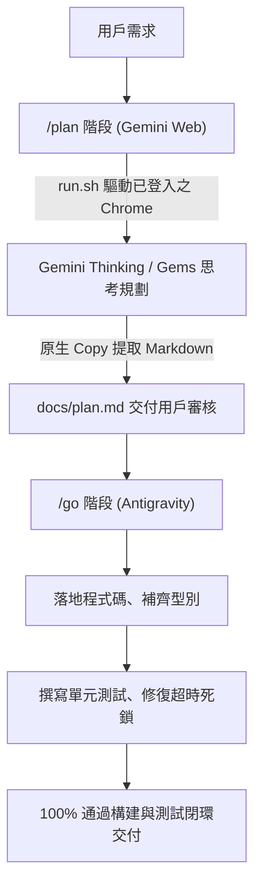

# Gemini Web Copilot for Google Antigravity 🚀

[](https://github.com/workingharry/gemini-web-copilot)
[](LICENSE)
[](https://www.python.org/)
[](https://playwright.dev/)

[繁體中文](#繁體中文) | [English](#english)

---

<a name="繁體中文"></a>
## 繁體中文

**Gemini Web Copilot** 是一個專為 [Google Antigravity](https://deepmind.google/technologies/gemini/) 打造的自定義技能（Skill）與子代理人（Subagent）。它透過真實 Chrome 瀏覽器自動化（CDP 協議）直接連接使用者的 [Google Gemini 網頁版](https://gemini.google.com)，藉助其強大的 **Thinking 深度思考模式**、**長上下文視窗** 或 **自訂 Gems** 進行架構規劃（Planning）與代碼撰寫（Coding），並將成果 100% 無失真提取回專案進行除錯與驗證。

### ✨ 核心特性

- 🎯 **免重複登入（Session 持久化）**：採用獨立 Chrome Profile (`~/.gemini/chrome_profile`)，用戶僅需在真實 Chrome 登入一次，後續調用永久復用。
- 🛡️ **避開 Chrome v136+ 安全限制**：規避新版 Chrome 禁止預設目錄開啟 `--remote-debugging-port` 的限制，專用 9333 端口杜絕衝突。
- ⚡ **精準生成監控**：不依賴空輸入框時會隱藏的 Send 按鈕，改為精準監聽 Stop 按鈕消失及 Action bar 出現。
- 📋 **原生 Markdown 無失真複製**：自動點擊最新回覆底部的原生「複製」按鈕，從系統剪貼簿讀取純淨 Markdown，徹底解決 DOM 爬取導致的縮排錯亂與雜訊問題。
- 🚀 **大檔案與超長 Context 支援**：支援原生檔案附件上傳或剪貼簿快速注入，防止長 Prompt 導致瀏覽器凍結。
- 🔄 **雙階工作流完美契合**：深度整合 `/plan`（Gemini Web 負責架構規劃）與 `/go`（Antigravity 負責實作、測試與除錯）。

---

### 📦 跨電腦一鍵安裝 (1-Line Install)

在任何電腦（macOS / Linux）的終端機中，只需貼上並執行此單行指令：

```bash
curl -fsSL https://raw.githubusercontent.com/workingharry/gemini-web-copilot/main/install.sh | bash
```

> **或者手動 Clone 安裝：**
> ```bash
> git clone https://github.com/workingharry/gemini-web-copilot.git ~/.gemini/config/skills/gemini-web-copilot
> cd ~/.gemini/config/skills/gemini-web-copilot && bash scripts/setup_env.sh
> ```

---

### 🚀 首次使用設定（只需一次）

在新電腦安裝完畢後，執行以下指令拉起獨立 Chrome 視窗：

```bash
bash ~/.gemini/config/skills/gemini-web-copilot/scripts/run.sh --launch-only
```
- 在彈出的 Chrome 視窗中登入您的 Google / Gemini 帳號。
- 登入完成後即可關閉或留著視窗，Session 永久生效！

---

### 💡 在 Antigravity 中使用：`/plan` 與 `/go`



1. **架構規劃 (`/plan`)**：
   在 Antigravity 對話框輸入：
   > `/plan 請調用 Gemini Web 幫我規劃微服務架構與重構方案`
   Antigravity 會自動調度 `gemini-web-copilot` 送往 Gemini Web，產出架構設計圖與分階段實施計畫。

2. **落地執行與除錯 (`/go`)**：
   在計畫產出後輸入：
   > `/go 開始實作並修復單元測試`
   Antigravity 會全自動接手執行計畫、撰寫代碼、撰寫單元測試、修復非同步超時競爭與邊界錯誤。

---

### 🛠️ 獨立終端命令列 (CLI Usage)

```bash
# 1. 單純傳送文字提示詞並印出回應
bash ~/.gemini/config/skills/gemini-web-copilot/scripts/run.sh \
  --prompt "請幫我設計一個支援指數退避的 TypeScript 重試模組"

# 2. 攜帶 Context 檔案並直接保存產出
bash ~/.gemini/config/skills/gemini-web-copilot/scripts/run.sh \
  --prompt "請重構此程式碼" \
  --context-file ./src/app.ts \
  --output ./docs/refactored.md

# 3. 執行系統與連線健康診斷
~/.gemini/gemini_copilot_env/bin/python ~/.gemini/config/skills/gemini-web-copilot/scripts/debug_gemini_skill.py
```

---

<a name="english"></a>
## English

**Gemini Web Copilot** is a custom Skill & Subagent tailored for [Google Antigravity](https://deepmind.google/technologies/gemini/). It connects directly to your [Google Gemini Web UI](https://gemini.google.com) via Chrome DevTools Protocol (CDP), allowing Antigravity to harness Gemini's **Deep Thinking model**, **ultra-long context window**, or **custom Gems** for architecture planning and code generation.

### 🌟 Key Highlights

1. **Zero-Friction Authentication**: Uses an isolated Chrome user data directory (`~/.gemini/chrome_profile`). Sign in once with Google 2FA, and cookies/session persist permanently.
2. **Chrome v136+ Security Compliant**: Uses dedicated CDP port `9333` and explicit profile paths to avoid new Chrome remote debugging restrictions.
3. **Stop & Action-bar Monitoring**: Waits for generation completion without relying on the empty-input Send button.
4. **Fidelity Markdown via Native Copy**: Clicks Gemini's native copy button to retrieve clean, untouched markdown directly from the clipboard.
5. **Seamless /plan & /go Integration**: Plan with Gemini Web, then implement and debug with Antigravity.

### 📦 Quick Installation (1-Line Command)

Run this single command on any machine:
```bash
curl -fsSL https://raw.githubusercontent.com/workingharry/gemini-web-copilot/main/install.sh | bash
```

---

## 📄 License

Distributed under the [MIT License](LICENSE). Copyright (c) 2026 workingharry.
