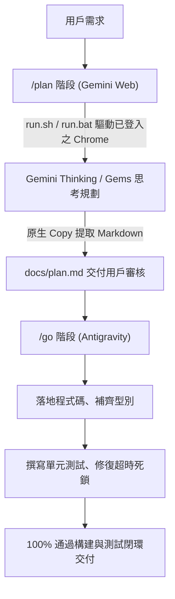

# Gemini Web Copilot for Google Antigravity 🚀

[](https://github.com/workingharry/gemini-web-copilot)
[](https://github.com/workingharry/gemini-web-copilot)
[](LICENSE)
[](https://www.python.org/)
[](https://playwright.dev/)

[繁體中文](#繁體中文) | [English](#english)

---

<a name="繁體中文"></a>
## 繁體中文

**Gemini Web Copilot** 是一個專為 [Google Antigravity](https://deepmind.google/technologies/gemini/) 打造的自定義技能（Skill）與子代理人（Subagent）。它透過真實 Chrome 瀏覽器自動化（CDP 協議）直接連接使用者的 [Google Gemini 網頁版](https://gemini.google.com)，藉助其強大的 **Thinking 深度思考模式**、**長上下文視窗** 或 **自訂 Gems** 進行架構規劃（Planning）與代碼撰寫（Coding），並將成果 100% 無失真提取回專案進行除錯與驗證。

### 💻 完美支援三大作業系統 (Cross-Platform)

- 🍏 **macOS**：支援 Apple Silicon (M1/M2/M3/M4) 與 Intel Mac，自動適配 `Meta+V` 剪貼簿注入與獨立 Session 脫鉤。
- 🪟 **Windows**：支援 Windows 10 / 11（PowerShell、CMD 與 WSL），自動尋找 `Program Files` 預設 Chrome，自動適配 `Control+V` 與 `DETACHED_PROCESS` 進程分離。
- 🐧 **Linux**：支援 Ubuntu、Debian、Fedora 等主流發行版。

---

### ✨ 核心特性

- 🎯 **免重複登入（Session 持久化）**：採用獨立 Chrome Profile (`~/.gemini/chrome_profile`)，用戶僅需在真實 Chrome 登入一次，後續調用永久復用。
- 🛡️ **避開 Chrome v136+ 安全限制**：規避新版 Chrome 禁止預設目錄開啟 `--remote-debugging-port` 的限制，專用 9333 端口杜絕衝突。
- ⚡ **精準生成監控**：不依賴空輸入框時會隱藏的 Send 按鈕，改為精準監聽 Stop 按鈕消失及 Action bar 出現。
- 📋 **原生 Markdown 無失真複製**：自動點擊最新回覆底部的原生「複製」按鈕，從系統剪貼簿讀取純淨 Markdown，徹底解決 DOM 爬取導致的縮排錯亂與雜訊問題。
- 🚀 **大檔案與超長 Context 支援**：支援原生檔案附件上傳或剪貼簿快速注入，防止長 Prompt 導致瀏覽器凍結。
- 🔄 **雙階工作流完美契合**：深度整合 `/plan`（Gemini Web 負責架構規劃）與 `/go`（Antigravity 負責實作、測試與除錯）。

---

### 📦 一鍵跨電腦安裝 (1-Line Install)

#### 🍏 macOS / 🐧 Linux：
在終端機中執行：
```bash
curl -fsSL https://raw.githubusercontent.com/workingharry/gemini-web-copilot/main/install.sh | bash
```

#### 🪟 Windows (PowerShell)：
在 PowerShell 中執行：
```powershell
irm https://raw.githubusercontent.com/workingharry/gemini-web-copilot/main/install.ps1 | iex
```

---

### 🚀 首次使用設定（只需一次）

在新電腦安裝完畢後，執行以下指令拉起獨立 Chrome 視窗：

- **macOS / Linux**：
  ```bash
  bash ~/.gemini/config/skills/gemini-web-copilot/scripts/run.sh --launch-only
  ```
- **Windows (CMD / PowerShell)**：
  ```cmd
  "%USERPROFILE%\.gemini\config\skills\gemini-web-copilot\scripts\run.bat" --launch-only
  ```
在彈出的 Chrome 視窗中登入您的 Google / Gemini 帳號，Session 永久生效！

---

### 💡 在 Antigravity 中使用：`/plan` 與 `/go`



1. **架構規劃 (`/plan`)**：
   在 Antigravity 對話框輸入：
   > `/plan 請調用 Gemini Web 幫我規劃微服務架構與重構方案`
   Antigravity 會自動調度 `gemini-web-copilot` 送往 Gemini Web，產出架構設計圖與分階段實施計畫。

2. **落地執行與除錯 (`/go`)**：
   在計畫產出後輸入：
   > `/go 開始實作並修復單元測試`
   Antigravity 會全自動接手執行計畫、撰寫代碼、撰寫單元測試、修復非同步超時競爭與邊界錯誤。

---

### 🛠️ 獨立終端命令列 (CLI Usage)

#### macOS / Linux:
```bash
# 1. 深度架構規劃 (Plan Mode) - 自動分析專案架構與依賴
bash ~/.gemini/config/skills/gemini-web-copilot/scripts/run.sh \
  --task plan \
  --instructions "請設計一個具備冪等性與死信佇列的付款處理管道" \
  --auto-context \
  --include ./package.json ./src/services/payment.ts \
  --output ./docs/architecture_plan.md

# 2. 嚴格代碼實作 (Code Mode) - 攜帶相關源碼，要求 0 佔位符與完整測試
bash ~/.gemini/config/skills/gemini-web-copilot/scripts/run.sh \
  --task code \
  --instructions "根據付款設計實作 PaymentProcessor 類別" \
  --include ./src/services/payment.ts \
  --output ./src/services/PaymentProcessor.ts

# 3. 根因除錯診斷 (Debug Mode) - 攜帶錯誤日誌與問題源碼
bash ~/.gemini/config/skills/gemini-web-copilot/scripts/run.sh \
  --task debug \
  --instructions "修復併發付款時出現的 LockTimeoutException" \
  --include ./logs/error.log ./src/services/payment.ts \
  --output ./docs/rca_fix.md
```

#### Windows:
```cmd
"%USERPROFILE%\.gemini\config\skills\gemini-web-copilot\scripts\run.bat" --task plan --instructions "請規劃重構方案" --auto-context --output .\docs\plan.md
```


---

<a name="english"></a>
## English

**Gemini Web Copilot** is a custom Skill & Subagent tailored for [Google Antigravity](https://deepmind.google/technologies/gemini/). It connects directly to your [Google Gemini Web UI](https://gemini.google.com) via Chrome DevTools Protocol (CDP), allowing Antigravity to harness Gemini's **Deep Thinking model**, **ultra-long context window**, or **custom Gems** for architecture planning and code generation.

### 💻 Triple-Platform Support
- 🍏 **macOS**: Native `Meta+V` injection, `setsid()` daemonization.
- 🪟 **Windows**: PowerShell installer (`install.ps1`), `run.bat`, `start_chrome_debug.bat`, `Control+V` paste handling, `DETACHED_PROCESS` separation.
- 🐧 **Linux**: Native curl installer, chromium binary resolution.

### 📦 Quick Installation (1-Line Command)

**macOS / Linux:**
```bash
curl -fsSL https://raw.githubusercontent.com/workingharry/gemini-web-copilot/main/install.sh | bash
```

**Windows (PowerShell):**
```powershell
irm https://raw.githubusercontent.com/workingharry/gemini-web-copilot/main/install.ps1 | iex
```

---

## 📄 License

Distributed under the [MIT License](LICENSE). Copyright (c) 2026 workingharry.
