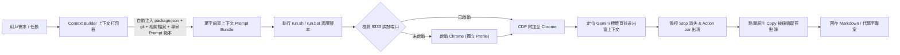

# Gemini Web Copilot Skill

本技能讓 Antigravity 能夠自動調用瀏覽器進入使用者的 Google Gemini 網頁版（[gemini.google.com](https://gemini.google.com)），藉由其進階推理、長上下文視窗、Thinking 模式或自訂 Gems 協助進行專案架構規劃 (Planning) 與代碼撰寫 (Code Generation)，並自動將原生 Markdown 結果提取回專案。

---

## 核心工作流 (Workflow)



---

## 最佳實踐指令 (Context-Aware Execution Guide)

> [!IMPORTANT]
> **嚴禁直接發送簡陋、無上下文的單句 Prompt**。
> Gemini 網頁版（尤其是 Thinking / 1.5 Pro / 2.0 模型）擁有高達 100 萬～200 萬 Token 的超長上下文視窗。調用時**必須**搭配 `--task`、`--auto-context` 以及 `--include` 傳入專案相關檔案，以發揮其極致推理能力！

### 1. 深度架構規劃 (`/plan`)
自動掃描專案元數據、目錄樹結構，並附帶相關核心檔案：
```bash
bash ~/.gemini/config/skills/gemini-web-copilot/scripts/run.sh \
  --task plan \
  --instructions "請為當前系統設計高併發與防雪崩之資料同步與快取架構" \
  --auto-context \
  --include src/main.tsx package.json \
  --output ./docs/architecture_plan.md
```

### 2. 生產級代碼生成 (`/code`)
附帶既有介面定義與依賴，要求 Gemini 輸出零省略號、具備完整單元測試的落地代碼：
```bash
bash ~/.gemini/config/skills/gemini-web-copilot/scripts/run.sh \
  --task code \
  --instructions "請根據現有型別定義，實作完整的資料同步器模組，包含指數退避與單元測試" \
  --include src/utils/retryWithBackoff.ts \
  --output ./src/utils/dataSynchronizer.ts
```

### 3. 系統級除錯與根本原因分析 (`/debug`)
附帶報錯日誌、堆疊追蹤與嫌疑檔案，要求進行 RCA 與最小侵入性修復：
```bash
bash ~/.gemini/config/skills/gemini-web-copilot/scripts/run.sh \
  --task debug \
  --instructions "排查此非同步工作在超時時卡死的原因並提供修復方案" \
  --include src/utils/retryWithBackoff.ts \
  --output ./docs/rca_report.md
```

### 4. 僅啟動並確認 Chrome 連線就緒（首次登入時使用）
```bash
bash ~/.gemini/config/skills/gemini-web-copilot/scripts/run.sh --launch-only
```

---

## 關鍵技術防護機制

1. **智慧上下文打包引擎 (`context_builder.py`)**：
   - 自動提取 `package.json`、`requirements.txt`、專案目錄結構樹、Git 狀態與最新變更。
   - 自動將傳入的原始碼檔案依語言類型（TypeScript, Python, Go 等）格式化為精準的 Markdown 區塊。
   - 自動套用專業資深架構師 / 工程師提示詞範本（包含零偽代碼、防禦性編程、單元測試規範等要求）。
2. **新版 Chrome (v136+) 安全限制避讓**：
   - 啟動時強制指定獨立目錄 `--user-data-dir="$HOME/.gemini/chrome_profile"`，專用 9333 端口。
   - 首次登入後，Google Session 與 Cookies 永久保存於該目錄，後續無感復用。
3. **Double-Fork 與 Session 守護進程分離**：
   - 啟動 Chrome 時透過 `start_new_session=True` / `setsid()` 脫離 Agent 的 Process Group，關閉所有標準 FD，徹底避免產生孤兒背景任務（Orphaned Task）。
4. **生成結束精準判定**：
   - 嚴禁依賴 Send 按鈕（輸入框為空時 Send 按鈕為隱藏/禁用狀態）。
   - 腳本監聽「Stop 按鈕出現後消失」，並且最新回覆底部的「Copy（複製）按鈕」穩定出現才判定為完成。
5. **原生 Markdown 無失真複製**：
   - 生成完畢後直接點擊最新回覆底部的原生 Copy 按鈕，並從系統剪貼簿讀取完整 Markdown，徹底避免 DOM 擷取導致的縮排錯亂與雜訊標籤。
6. **超長 Context 防卡死**：
   - 文字量較大時採用系統剪貼簿快速注入（`Meta+V` / `Control+V`）或直接透過原生 File Input 上傳檔案附件，防止瀏覽器編輯器凍結。

---

## 相關參考文件
- [智慧上下文打包器源碼](./scripts/context_builder.py)
- [Prompt 範本庫 (Templates)](./templates/)
- [DOM 選擇器與交互規範](./references/selectors.md)
- [常見問題與排障指南](./references/troubleshooting.md)
