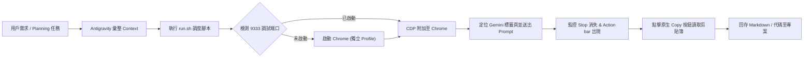

# Gemini Web Copilot Skill

本技能讓 Antigravity 能夠自動調用瀏覽器進入使用者的 Google Gemini 網頁版（[gemini.google.com](https://gemini.google.com)），藉由其進階推理、長上下文視窗、Thinking 模式或自訂 Gems 協助進行專案架構規劃 (Planning) 與代碼撰寫 (Code Generation)，並自動將原生 Markdown 結果提取回專案。

---

## 核心工作流 (Workflow)



---

## 快速使用指令 (Execution Guide)

當需要調用 Gemini 網頁版時，可在終端機中執行該技能自帶的封裝腳本 `run.sh`：

### 1. 單純傳送文字 Prompt 並取得回應
```bash
bash .agent/skills/gemini-web-copilot/scripts/run.sh \
  --prompt "請幫我針對當前專案架構撰寫一份詳細的實作計畫，包含模組劃分與時程。"
```

### 2. 攜帶檔案 Context 與提示詞檔案，並將結果存檔
```bash
bash .agent/skills/gemini-web-copilot/scripts/run.sh \
  --prompt-file .agent/skills/gemini-web-copilot/examples/planning_prompt.md \
  --context-file ./src/main.ts \
  --output ./docs/gemini_plan.md
```

### 3. 僅啟動並確認 Chrome 連線就緒（首次登入時使用）
```bash
bash .agent/skills/gemini-web-copilot/scripts/run.sh --launch-only
```

---

## 關鍵技術防護機制

1. **新版 Chrome (v136+) 安全限制避讓**：
   - 啟動時強制指定獨立目錄 `--user-data-dir="$HOME/.gemini/chrome_profile"`，避免被系統阻擋開啟 9333 調試端口。
   - 首次登入後，Google Session 與 Cookies 永久保存於該目錄，後續無感復用。
2. **生成結束精準判定**：
   - 嚴禁依賴 Send 按鈕（輸入框為空時 Send 按鈕為隱藏/禁用狀態）。
   - 腳本監聽「Stop 按鈕出現後消失」，並且最新回覆底部的「Copy（複製）按鈕」穩定出現才判定為完成。
3. **原生 Markdown 無失真複製**：
   - 生成完畢後直接點擊最新回覆底部的原生 Copy 按鈕，並從系統剪貼簿讀取完整 Markdown，徹底避免 DOM 擷取導致的縮排錯亂與雜訊標籤。
4. **超長 Context 防卡死**：
   - 文字量較大時採用系統剪貼簿快速注入（Cmd+V）或直接透過原生 File Input 上傳檔案附件，防止瀏覽器編輯器凍結。

---

## 相關參考文件
- [DOM 選擇器與交互規範](./references/selectors.md)
- [常見問題與排障指南](./references/troubleshooting.md)
- [代碼生成提示詞範本](./examples/code_generation_prompt.md)
- [系統規劃提示詞範本](./examples/planning_prompt.md)
