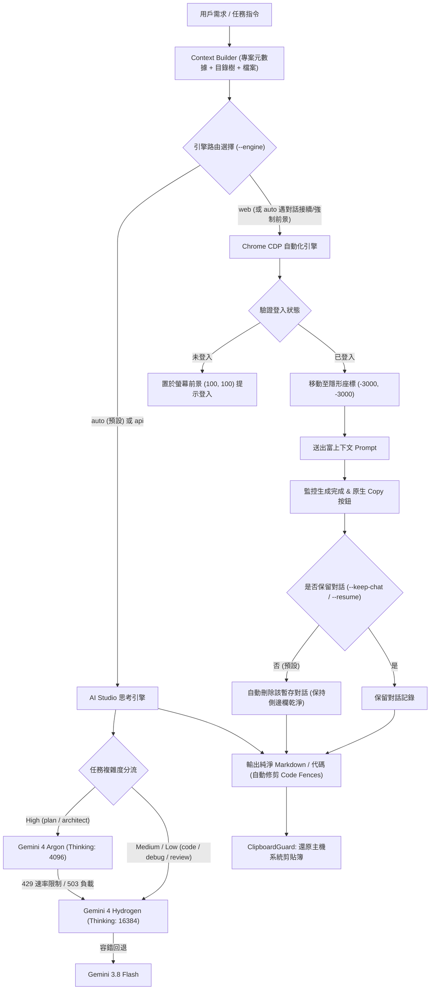

# Gemini Web Copilot Skill

本技能為 Antigravity 的 Google Gemini 雙引擎調度橋樑：
1. **Google AI Studio 旗艦思考引擎 (`--engine api` / `--engine auto`)**：
   - 原生支援 **Gemini 4 Argon**（高階架構規劃，中等思考預算 4,096 tokens）與 **Gemini 4 Hydrogen**（生產代碼與除錯，高階思考預算 16,384 tokens）。
   - 自動連鎖容錯回退（Argon 429 ➔ Hydrogen ➔ 3.8 Flash），零瀏覽器延遲，毫秒級啟動。
2. **Gemini 網頁版 CDP 自動化引擎 (`--engine web`)**：
   - 驅動使用者本機 Chrome 存取 [gemini.google.com](https://gemini.google.com)。
   - 認證狀態感知（未登入置於前景，已登入背景執行），徹底杜絕盲目離屏卡死。
   - 支援專案未完成之既有對話恢復（`--chat-url` / `--resume`）。
   - 自動刪除暫存對話（`--keep-chat` 可選保留），維持 Gemini 側邊欄 100% 乾淨。
   - 剪貼簿原子隔離防護（`ClipboardGuard`），保護主機桌面剪貼簿不被覆蓋破壞。

---

## 核心架構工作流



---

## 最佳實踐指令 (CLI Usage Guide)

### 1. 深度架構規劃 (`--task plan` / `--task architect`)
自動採用 `gemini-4-argon`（中等思考預算 4k），打包專案目錄樹與核心檔案：
```bash
bash ~/.gemini/config/skills/gemini-web-copilot/scripts/run.sh \
  --task plan \
  --instructions "請為當前系統設計高併發與防雪崩之資料同步與快取架構" \
  --auto-context \
  --include src/main.tsx package.json \
  --output ./docs/architecture_plan.md
```

### 2. 生產級代碼生成 (`--task code`)
自動採用 `gemini-4-hydrogen`（高階思考預算 16k），附帶型別定義，輸出零省略號的實作代碼：
```bash
bash ~/.gemini/config/skills/gemini-web-copilot/scripts/run.sh \
  --task code \
  --instructions "實作完整的指數退避重試器與單元測試" \
  --include src/types.ts \
  --output ./src/utils/retryWithBackoff.ts
```

### 3. 系統級除錯與根本原因分析 (`--task debug`)
附帶報錯日誌與嫌疑檔案，進行 RCA 與最小侵入性修復：
```bash
bash ~/.gemini/config/skills/gemini-web-copilot/scripts/run.sh \
  --task debug \
  --instructions "排查非同步工作超時卡死原因並提供修復" \
  --include src/worker.ts \
  --output ./docs/rca_report.md
```

### 4. 網頁版接續未完成專案 (`--chat-url` / `--resume`)
若先前對話尚未結束，可傳入對話網址繼續對話，並保留該歷史記錄：
```bash
bash ~/.gemini/config/skills/gemini-web-copilot/scripts/run.sh \
  --engine web \
  --resume "https://gemini.google.com/app/1a2b3c4d5e6f" \
  --instructions "接續上一回合，補充第 3 點的單元測試" \
  --keep-chat
```

### 5. 指定自訂模型與思考預算
```bash
bash ~/.gemini/config/skills/gemini-web-copilot/scripts/run.sh \
  --model gemini-4-hydrogen \
  --thinking 8192 \
  --instructions "快速審查此資料結構的記憶體對齊"
```

---

## 關鍵技術防護機制

1. **AI Studio 原生思考層級與連鎖容錯**：
   - 根據任務複雜度自動配置 `thinkingBudget`。
   - 面對 HTTP 429 或 503 時，自動無感瀑布回退（Argon ➔ Hydrogen ➔ 3.8 Flash）。
2. **認證狀態感知與離屏卡死免疫**：
   - 啟動時先以可視座標檢查登入狀態。
   - 僅在確認登入成功後才移至離屏座標；若需要登入或驗證碼，維持在螢幕中央並提示使用者。
3. **對話側邊欄自動清理**：
   - 預設在提取完回應後，自動觸發選單刪除該暫存對話，杜絕側邊欄堆積廢棄對話。
   - 支援 `--keep-chat` 或 `--resume` 保留長期專案。
4. **桌面剪貼簿原子隔離 (`ClipboardGuard`)**：
   - 進入前備份桌面剪貼簿，退出前自動完整還原。
   - 透過 `/tmp/antigravity_browser_copilot.lock` 檔案互斥鎖防止多行程 CDP 端口衝突。
